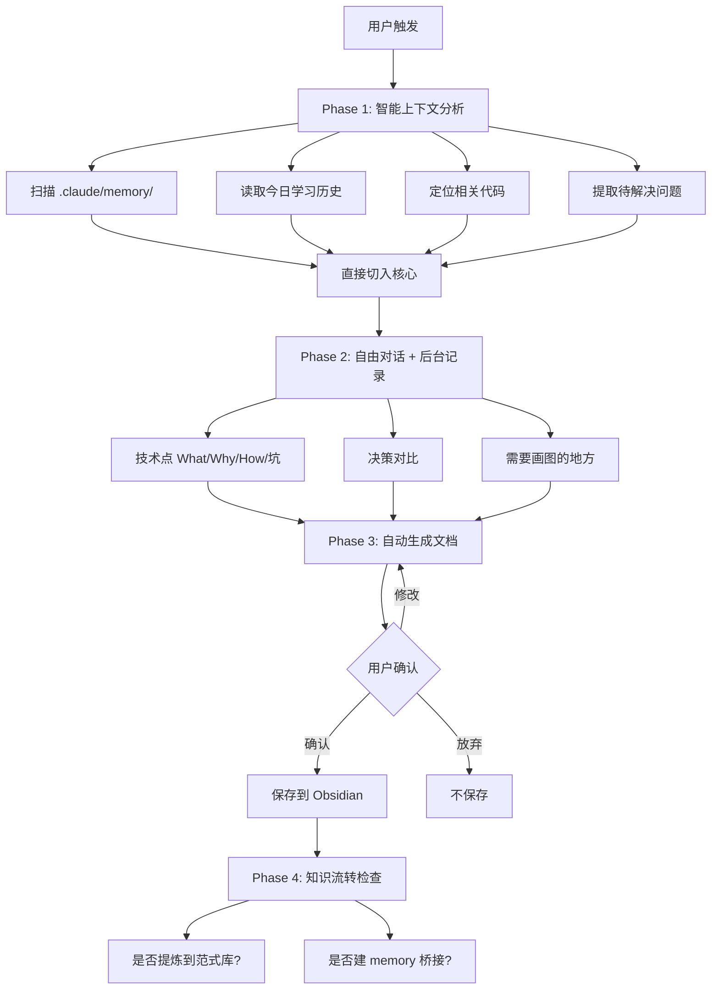

# AI Tech Learn v2.0

> 智能AI工程学习 Skill——自动分析上下文，直接切入核心，对话结束自动沉淀。

[](https://claude.ai/code)
[](https://github.com/longhuang1997-cpu/AI-Tech-Learn)
[](LICENSE)

**语言 / Language**：[中文](#) · [English](README_EN.md)

---

## 🎯 这是什么

AI Tech Learn 是一个 Claude Code Skill，把每次技术讨论自动转化成**可复用的知识资产**。

它做三件事：
1. **问之前**：自动扫描你的记忆、代码、项目历史，直接切入核心，不问废话
2. **谈话中**：后台默默记录技术点、决策对比、架构图需求
3. **谈完后**：一键生成结构化学习文档，确认后保存到 Obsidian

---

## ✨ 核心功能

- 🧠 **智能上下文分析**：对话开始前自动扫描 `.claude/memory/`、相关代码、今天的学习记录
- 🤖 **自动沉淀**：对话结束时自动生成文档，含架构图（Mermaid）、决策表、关联项目
- 📝 **一天一份原则**：同一天的内容自动合并到同一文件，不产生碎片
- 🔄 **知识流转提醒**：自动判断是否成熟，提示你提炼到范式库
- 📊 **健康检查**：定期扫描知识库，发现僵尸文档、断链、低质量 MOC

---

## 🚀 快速开始

### 1. 安装

```bash
# 克隆到 Claude Code skills 目录
cd ~/.claude/skills
git clone https://github.com/longhuang1997-cpu/AI-Tech-Learn.git ai-tech-learn
```

### 2. 触发方式

在 Claude Code 对话中，说以下任意一种：

```
/ai-tech-learn
今天学 XXX 技术
搞懂 XXX 原理
研究 XXX 算法
深入 XXX 架构
```

### 3. 对话效果

```
你：今天学混合检索权重调参

📊 上下文分析
  记忆：你在 2026-11-10 完成了 BM25 混合检索集成（准确率+20%）
  代码：当前权重配置在 obsidian_vectorize.py:45（0.3/0.7）
  待解决：P1 - 权重调参（未开始）
  项目：丹田知识中台

直接切入：你想优化权重对吧？建议先建评估集，再做 A/B 测试。要我设计评估方案吗？
```

---

## 📋 执行流程



---

## 📁 仓库结构

```
AI-Tech-Learn/
├── README.md                        ← 中文文档（本文件）
├── README_EN.md                     ← English docs
├── SKILL.md                         ← Claude Code skill 定义（核心）
├── LICENSE                          ← MIT
├── scripts/
│   ├── health_check_v2.py           ← 知识库健康检查工具
│   ├── frontmatter_standardize.py   ← Frontmatter 标准化工具
│   └── requirements.txt             ← 依赖说明（仅标准库）
└── templates/
    └── ai-tech-dialogue.md          ← 学习档案模板
```

---

## 🛠 配套脚本

### 知识库健康检查

扫描范式库和 MOC，生成健康度报告：

```bash
python scripts/health_check_v2.py "/path/to/your/Obsidian Vault"
```

报告会保存到 `04_AI_Capability_Library/Methodology/_health-report-YYYY-MM-DD.md`

自定义文件夹名称：

```bash
export AI_TECH_METHODOLOGY_FOLDER="04_AI_能力库/范式库"
export AI_TECH_MOC_FOLDER="60_MOC"
python scripts/health_check_v2.py "/path/to/vault"
```

### Frontmatter 标准化

统一 Obsidian 笔记的 frontmatter 字段：

```bash
# 先干运行，只看会改什么，不实际修改
python scripts/frontmatter_standardize.py "/path/to/vault"

# 确认没问题后，实际执行（会自动备份原文件）
python scripts/frontmatter_standardize.py "/path/to/vault" --apply
```

---

## 📂 文档保存位置

| 模式 | 保存位置 |
|------|---------|
| 学习模式 | `30_Learning/AI工程对话/YYYY-MM-DD-主题.md` |
| 项目模式 | `10_Work/Product/[项目名]/Wiki/YYYY-MM-DD-技术点.md` |
| 健康报告 | `04_AI_Capability_Library/Methodology/_health-report-YYYY-MM-DD.md` |

> 文件夹名称可以在 `SKILL.md` 里按你的 vault 结构修改。

---

## 📝 生成文档的格式

每份学习档案包含：

- **问题起源**：为什么今天研究这个
- **核心技术点**：What / Why / How / 踩坑
- **架构图**（Mermaid）
- **技术决策表**：选项对比
- **关联项目**：链接到 `10_Work/Product/`
- **待解决问题**：P0 / P1 / P2 分级

模板在 `templates/ai-tech-dialogue.md`，可以直接复制使用。

---

## 🔄 知识流转机制

```
对话碎片 (L1)
    ↓ 讨论 ≥3 次 + 跨 ≥2 个项目
范式文档 (L2)  →  04_AI_Capability_Library/
    ↓ 同域范式 ≥5 个
元范式 (L3)    →  方法论合集
```

触发条件（自动检测）：
- 同一技术点讨论次数 ≥ 3
- 跨 ≥ 2 个项目应用
- 待解决问题全部清零

---

## ⚙️ 配置

默认路径约定（相对 vault 根目录，可在 `SKILL.md` 修改）：

```
学习对话目录：  30_Learning/AI工程对话/
项目 Wiki 目录：10_Work/Product/{project}/Wiki/
范式库目录：    04_AI_Capability_Library/Methodology/
```

通过环境变量覆盖健康检查的目录：

```bash
export AI_TECH_METHODOLOGY_FOLDER="04_AI_能力库/范式库"
export AI_TECH_MOC_FOLDER="60_MOC"
export AI_TECH_REPORT_FOLDER="04_AI_能力库/范式库"
```

---

## 🤝 贡献

欢迎提 Issue 和 PR：

1. Fork 本仓库
2. 创建 feature 分支（`git checkout -b feature/xxx`）
3. 提交改动
4. 发起 Pull Request

---

## 📄 License

MIT License — 见 [LICENSE](LICENSE)

---

## 📮 联系

- **Issues**：[GitHub Issues](https://github.com/longhuang1997-cpu/AI-Tech-Learn/issues)
- **Discussions**：[GitHub Discussions](https://github.com/longhuang1997-cpu/AI-Tech-Learn/discussions)
