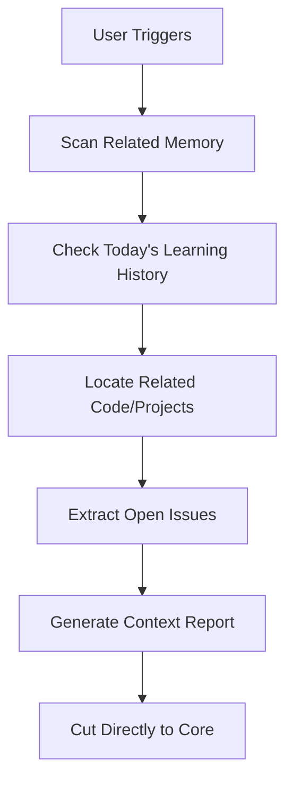

# AI Tech Learn v2.0

> Intelligent AI Engineering Learning Skill - Automatic context analysis, direct to core, automatic knowledge distillation after conversation ends.

[](https://claude.ai/code)
[](https://github.com/yourusername/ai-tech-learn)
[](LICENSE)

---

## 🎯 What is AI Tech Learn?

AI Tech Learn is an intelligent learning companion skill for Claude Code that transforms technical discussions into structured, reusable knowledge assets. It automatically analyzes conversation context, extracts technical insights, and generates comprehensive learning documentation without manual intervention.

### Key Features

- 🧠 **Smart Context Analysis**: Automatically scans memory, code, and project history before answering
- 🤖 **Automatic Distillation**: Records technical points in background, generates documentation when conversation ends
- 📊 **Rich Visualizations**: Auto-generates Mermaid diagrams, comparison tables, and decision matrices
- 🔄 **Knowledge Flow Management**: Suggests when to promote learnings to methodology library
- 📝 **One Document Per Day**: Intelligent merging of related topics within same day

---

## 🚀 Core Upgrades (v2.0)

### 🧠 Smart Context Analysis (New)

**Executes automatically before user asks**:
1. **Scan Memory**: Retrieves relevant technical memories from `.claude/memory/`
2. **Read Project Code**: Locates related files if user mentions specific tech
3. **Check Learning History**: Finds today/recent learning on related topics
4. **Extract Open Issues**: Identifies P0/P1 problems from existing conversations
5. **Link Projects**: Auto-identifies which `10_Work/Product/` projects are involved

**Output Format**:
```
📊 Context Analysis
- Memory: You completed BM25 hybrid search on 2026-11-10 (+20% accuracy)
- Code: Current weight config in obsidian_vectorize.py:45 (0.3/0.7)
- Open Issues: P1 - Weight tuning (not started)
- Projects: Dantian Knowledge Platform

Now cutting to the chase: You want to optimize weight config right? I suggest...
```

### 🤖 Automatic Distillation Mode (New)

**Records in background during conversation**:
- Technical points (What/Why/How/Pitfalls)
- Technical decisions (Option comparison tables)
- Architecture diagram needs (identifies where diagrams needed)
- Related projects (auto-identification)

**Auto-generates when conversation ends**:
- Complete conversation file (with diagrams/tables/project links)
- One-click preview + confirmation mechanism

**Flow**:
```
You: [Ask technical questions, free conversation]
Me: [Answer, recording in background]
...conversation ends...
Me: [Auto-generate file content]
   
   📄 Generated today's learning document, please confirm:
   
   [Preview content]
   - Core tech points: Hybrid search weight tuning method
   - Architecture diagram: A/B testing workflow
   - Related projects: Dantian Knowledge Platform
   - Open issues: Build 20-query evaluation set
   
   ✅ Confirm & Save  📝 Modify  ❌ Discard
```

---

## 📋 Trigger Conditions

Activated when user says any of these keywords:
- "Learn XXX technology today"
- "Understand XXX principle"
- "Research XXX algorithm"
- "Deep dive into XXX architecture"
- `/ai-tech-learn` (direct invocation)

**Mode Recognition** (automatic):
- **Learning Mode**: User actively says "learn XX today"
  - Goal: Personal technical growth
  - Save location: `30_Learning/AI_Engineering_Dialogue/`
  
- **Project Mode**: Triggered after `/project-wiki` search fails
  - Goal: Solve project problem + supplement project wiki
  - Save location: `10_Work/Product/[project_name]/Wiki/`
  - Also: Append to today's learning doc (if exists)

---

## 🔄 v2.0 Execution Flow

### Phase 1: Smart Context Analysis (Automatic, User-Transparent)



**Specific Operations**:
1. **Scan `.claude/memory/`**
   - Search keyword-related memory files
   - Extract: Technical background, current status, known issues
   
2. **Check Learning History**
   - Read `30_Learning/AI_Engineering_Dialogue/` today's file (if exists)
   - Read recent 3 days' related conversations
   - Extract: Learned tech points, open issue list
   
3. **Locate Project Code** (if user mentions specific tech)
   - Search related Python/JS files
   - Extract: Current config, key parameters
   
4. **Auto-link Projects**
   - Scan `10_Work/Product/` related projects
   - Identify: Which projects apply this tech
   
5. **Generate Context Report**
   ```
   📊 Context Analysis
   
   Memory: [Related technical background]
   Code: [Current configuration]
   History: [Recent learning progress]
   Open Issues: [P0/P1 problem list]
   Projects: [Related projects]
   
   ---
   Now cutting to chase: [Context-based targeted opening]
   ```

### Phase 2: Free Conversation (User-Led, Background Recording)

**No more 3 fixed questions**, instead:
- Based on context analysis, directly give targeted suggestions/questions
- User asks freely, I answer freely
- **Background auto-recording**:
  - Tech points (What/Why/How/Pitfalls)
  - Technical decision comparisons
  - Places needing diagrams
  - Related projects

**Recording Format** (background, not visible to user):
```json
{
  "tech_points": [
    {
      "name": "Hybrid search weight tuning",
      "what": "...",
      "why": "...",
      "how": "...",
      "pitfalls": "..."
    }
  ],
  "decisions": [
    {
      "options": ["0.3/0.7", "0.5/0.5", "0.2/0.8"],
      "comparison": {...}
    }
  ],
  "diagrams_needed": ["A/B testing flow", "Weight optimization decision tree"],
  "related_projects": ["Dantian Knowledge Platform"]
}
```

### Phase 3: Auto-Generate Document (When Conversation Ends)

**Trigger Timing**:
- User says "that's it for today" / "enough" / "let's leave it here"
- Or conversation clearly reaches natural end

**Execution**:
1. **Determine Mode**
   - Learning mode → Check `30_Learning/AI_Engineering_Dialogue/` today's file
   - Project mode → Check `10_Work/Product/[project]/Wiki/` today's file

2. **Auto-generate based on background records**:
   - Core tech points chapters (with What/Why/How/Pitfalls)
   - Architecture diagrams (Mermaid code)
   - Technical decision tables
   - Related project tables
   - Open issues (auto-graded P0/P1/P2)

3. **Dual Save** (project mode specific):
   ```
   Project mode:
   1. Main doc: 10_Work/Product/[project]/Wiki/YYYY-MM-DD-tech-point.md
   2. Sync to learning doc (if exists today): 30_Learning/AI_Engineering_Dialogue/YYYY-MM-DD-topic.md
      → Auto-add in "Related Projects" section:
        "This tech point applied in [[10_Work/Product/[project]]],
         detailed wiki: [[10_Work/Product/[project]/Wiki/YYYY-MM-DD-tech-point]]"
   ```

4. **One-Click Confirmation**:
   ```
   📄 Generated document for you (project mode)
   
   === Preview ===
   [Full content]
   
   === Save Location ===
   Main doc: 10_Work/Product/ServicePlatform/Wiki/2026-11-17-hybrid-search.md
   Sync to: 30_Learning/AI_Engineering_Dialogue/2026-11-17-knowledge-engineering.md
   
   === Actions ===
   ✅ Confirm save (dual)
   📝 I want to modify XXX section
   ❌ Discard this record
   ```

4. **User Actions**:
   - Say "confirm" → Save to files
   - Say "modify XXX" → I modify then re-preview
   - Say "discard" → Don't save

### Phase 4: Knowledge Flow Check (Automatic)

After saving, auto-execute:
```
✅ Document saved: 30_Learning/AI_Engineering_Dialogue/2026-11-17-knowledge-engineering.md

📦 Knowledge Flow Check
- [ ] Is this tech point mature? → Extract to 04_AI_Capability_Library
- [ ] Will it be used frequently? → Build .claude/memory bridge
- [ ] Worth distilling to LLM Wiki? → Migrate to 30_Learning/LLM_Wiki

Flow now? (can do later)
```

---

## 📝 Document Structure

### Template (Simplified)

```markdown
---
type: ai-tech-dialogue
created: YYYY-MM-DD
last-updated: YYYY-MM-DD
tech_topics: []
core_tech_points: 
related_projects: []
priority: P1
---

# YYYY-MM-DD · [Topic]

## 🎯 Problem Origin

Why research this today? Triggered from which project?

## 💡 Core Technical Points

### [Tech Point A]

**What is it**:
**Why designed this way**:
**How to use**:
**Pitfall experiences**:

## 📊 Architecture Diagram

\`\`\`mermaid
graph TD
    
\`\`\`

## 🔗 Related Projects

| Project | How Used | Next Steps |
|---------|----------|------------|
| [[]] |  |  |

## ❓ Open Issues

### P0 - Blocking
1. 

### P1 - Important
1. 

## 🔗 Further Reading

- [[]] - 
```

---

## 🎓 Quality Standards (v2.0)

**Auto-generated doc must include**:
- ✅ At least 1 Mermaid architecture diagram (auto-identifies where diagrams needed)
- ✅ At least 1 technical decision table (if discussed options/comparisons)
- ✅ Link at least 1 10_Work project (auto-identified)
- ✅ List at least 1 open issue (extracted from conversation)

**Don't write**:
- ❌ Pure copy-paste technical docs
- ❌ Concept stacking without Why
- ❌ Pure theory unrelated to projects

---

## 🤖 Smart Function List

### 🎯 Auto-Analysis Capabilities
- [x] Scan related memory files
- [x] Read today/recent learning history
- [x] Locate related project code
- [x] Extract open issues
- [x] Auto-link 10_Work projects
- [x] Generate targeted opening

### 🤖 Background Recording Capabilities
- [x] Auto-identify tech points (What/Why/How/Pitfalls)
- [x] Auto-extract technical decision comparisons
- [x] Auto-mark places needing diagrams
- [x] Auto-identify related projects
- [x] Auto-grade open issues (P0/P1/P2)

### 📝 Auto-Generation Capabilities
- [x] Generate complete Markdown document
- [x] Generate Mermaid architecture diagram code
- [x] Generate technical decision tables
- [x] Generate related project tables
- [x] One-click preview + confirmation mechanism

### 🔄 Smart Merge Capabilities
- [x] Detect if today's file exists
- [x] Auto-append to corresponding sections
- [x] Update open issue status
- [x] Update frontmatter tech topics array
- [x] Avoid content duplication

---

## 📦 Installation

### Prerequisites
- Claude Code CLI installed
- Obsidian vault for knowledge management (recommended)

### Setup

1. **Clone or download this skill**:
```bash
cd ~/.claude/skills
git clone https://github.com/yourusername/ai-tech-learn.git
```

2. **Configure your vault path** (in SKILL.md):
```markdown
OBSIDIAN_VAULT_PATH = "/path/to/your/Obsidian Vault"
LEARNING_DIALOGUE_PATH = "30_Learning/AI_Engineering_Dialogue/"
```

3. **Test the skill**:
```bash
claude
> /ai-tech-learn
```

---

## 💡 Usage Examples

### Example 1: Learning New Technology

```
You: Learn hybrid search weight tuning today

Me: 📊 Context Analysis

Memory: You completed BM25 hybrid search on 2026-11-10
      - Current weight: 0.3 vector + 0.7 BM25
      - Accuracy improvement: +20%
      - Status: Phase A complete, Phase B not started

Code: obsidian_vectorize.py:45
      fusion_score = 0.3 * vector_score + 0.7 * bm25_score

Open Issues: P1 - Weight tuning (not started)
            P1 - Evaluation set building (not started)

Projects: Dantian Knowledge Platform

---
Cutting to chase: You want to optimize weight config right?
Current 0.3/0.7 is empirical. I suggest building evaluation set first, then A/B test.
Want me to design evaluation plan?
```

### Example 2: Auto-Generated Document

```
You: Got it, I'll go build the evaluation set

Me: Alright, let me summarize today's learning...

📄 Generated today's learning document

=== Preview ===

## 💡 Core Technical Points

### Hybrid Search Weight Tuning Method

**What is it**:
Optimize retrieval accuracy by adjusting fusion weight ratio between vector search and BM25.
Current config: 0.3 vector + 0.7 BM25

**Why needed**:
- Current weight is empirical, not scientifically validated
- Optimal weight may differ for different business scenarios
- Need A/B testing to find optimal config

**How to use**:
1. Build evaluation set (20 real queries + manual annotation of correct answers)
2. Design A/B test plan (try 0.5/0.5, 0.2/0.8)
3. Calculate accuracy/recall
4. Select optimal weight

**Pitfall experiences**:
- ⚠️ Evaluation set must cover different query types (exact match/semantic understanding)
- ⚠️ Avoid overfitting on small samples

...

=== Actions ===
✅ Confirm save
📝 I want to modify XXX section
❌ Discard this record
```

---

## 🔧 Configuration

### Customizing Save Locations

Edit `SKILL.md` to customize where documents are saved:

```markdown
# Default paths
LEARNING_DIALOGUE_PATH = "30_Learning/AI_Engineering_Dialogue/"
PROJECT_WIKI_PATH = "10_Work/Product/{project_name}/Wiki/"
CAPABILITY_LIBRARY_PATH = "04_AI_Capability_Library/Methodology/"
```

### Customizing Quality Standards

Adjust what's required in auto-generated docs:

```markdown
QUALITY_REQUIREMENTS = {
    "min_mermaid_diagrams": 1,
    "min_decision_tables": 1,
    "min_related_projects": 1,
    "min_open_issues": 1
}
```

---

## 📊 Output Styles

- **Concise**: Use tables over paragraphs, lists over tables when possible
- **Visual**: Architecture diagrams required, technical flows must be drawn
- **Practical**: Must link projects, must have "how to use"
- **Honest**: Mark unknowns as "to be researched", don't fabricate

---

## 🤝 Contributing

Contributions are welcome! Here's how you can help:

1. **Report Issues**: Found a bug? [Open an issue](https://github.com/yourusername/ai-tech-learn/issues)
2. **Suggest Features**: Have ideas? Share them in issues
3. **Submit PRs**: 
   - Fork the repo
   - Create your feature branch (`git checkout -b feature/AmazingFeature`)
   - Commit your changes (`git commit -m 'Add some AmazingFeature'`)
   - Push to the branch (`git push origin feature/AmazingFeature`)
   - Open a Pull Request

---

## 📄 License

This project is licensed under the MIT License - see the [LICENSE](LICENSE) file for details.

---

## 🙏 Acknowledgments

- Built for [Claude Code](https://claude.ai/code)
- Inspired by the Zettelkasten method and knowledge management best practices
- Thanks to all contributors and users

---

## 📮 Contact

- **Issues**: [GitHub Issues](https://github.com/yourusername/ai-tech-learn/issues)
- **Discussions**: [GitHub Discussions](https://github.com/yourusername/ai-tech-learn/discussions)
- **Email**: your.email@example.com

---

## 🗺️ Roadmap

### Phase A: Knowledge Distillation Automation (P1 - This Week)

Auto-detect when tech point is mature (discussed ≥3 times, applied in ≥2 projects) and prompt to extract to methodology library.

### Phase B: Case Library Auto-Build (P1 - This Week)

Extend each conversation with practical case tables and reusable code sections.

### Phase C: Knowledge Purification Mechanism (P1+ - 1 Month)

Auto-detect when same domain has ≥5 methodologies, suggest purification into meta-methodology.

### Phase D: Zombie Methodology Cleanup (P1+ - 1 Month)

Auto-detect methodologies unused for 90 days, prompt for archival or deletion.

### Phase E: Health Check (Manual Trigger)

Command-triggered scan of methodology library health metrics and generate report.

---

**Why make it a skill**: 
- ✅ Standardized process (every conversation follows same checklist)
- ✅ Automated operations (create files, update indices)
- ✅ Quality assurance (must include diagrams/project links)
- ✅ Knowledge flow (auto-remind when to extract)

**How to use**:
```
/ai-tech-learn
# Or directly say: "Learn XXX technology today"
```

---

Made with ❤️ by the Claude Code community