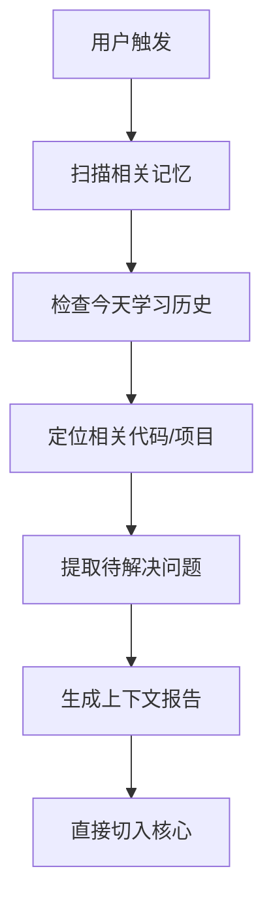
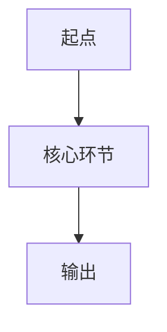
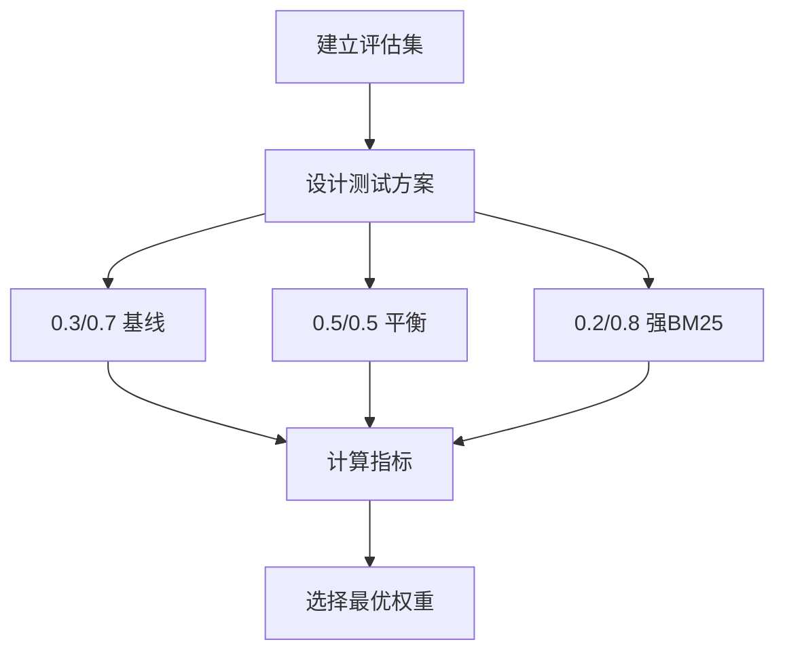

# AI Tech Learn v2.0

智能AI工程学习skill——自动分析上下文，直接切入核心，对话结束自动沉淀。

## 核心升级（v2.0）

### 🧠 智能上下文分析（新）
**在用户提问前，自动执行**：
1. **扫描记忆**：检索 `.claude/memory/` 中相关技术记忆
2. **读取项目代码**：定位相关文件（如果用户提到具体技术）
3. **检查学习历史**：今天/最近是否学过相关技术
4. **分析待解决问题**：从已有对话文件提取P0/P1问题
5. **关联项目**：自动识别这个技术涉及哪些 `10_Work/Product/` 项目

**输出格式**：
```
📊 上下文分析
- 记忆：你在2026-11-10完成了BM25混合检索集成（准确率+20%）
- 代码：当前权重配置在 obsidian_vectorize.py:45（0.3/0.7）
- 待解决：P1问题-权重调参（未开始）
- 项目：丹田知识中台

现在直接切入：你想优化权重配置对吧？我建议...
```

### 🤖 自动沉淀模式（新）
**对话过程中，后台自动记录**：
- 技术点（是什么/为什么/怎么用/踩坑）
- 技术决策（选项对比表）
- 架构图需求（识别需要画图的地方）
- 关联项目（自动识别）

**对话结束时，自动生成**：
- 完整的对话文件（含架构图/表格/项目链接）
- 一键预览+确认机制

**流程**：
```
你：[问技术问题，自由对话]
我：[解答，后台记录]
...对话结束...
我：[自动生成文件内容]
   
   📄 已为你生成今天的学习文档，请确认：
   
   [预览内容]
   - 核心技术点：混合检索权重调参方法
   - 架构图：A/B测试流程图
   - 关联项目：丹田知识中台
   - 待解决问题：建立20个查询的评估集
   
   ✅ 确认保存  📝 修改后保存  ❌ 放弃
```

## 触发条件

用户说出以下任一关键词时触发：
- "今天学XXX技术"
- "搞懂XXX原理"
- "研究XXX算法"
- "深入XXX架构"
- `/ai-tech-learn`（直接调用）

**模式识别**（自动判断）：
- **学习模式**：用户主动说"今天学XX"
  - 目标：个人技术提升
  - 沉淀位置：`30_Learning/AI工程对话/`
  
- **项目模式**：从 `/dantian-wiki` 检索失败后触发
  - 目标：解决项目问题 + 补充项目wiki
  - 沉淀位置：`10_Work/Product/[项目名]/Wiki/`
  - 同时：追加到今天的学习文档（如果有）

## v2.0 执行流程

### Phase 1: 智能上下文分析（自动执行，用户无感）



**具体操作**：
1. **扫描 `.claude/memory/`**
   - 搜索关键词相关的记忆文件
   - 提取：技术背景、当前状态、已知问题
   
2. **检查学习历史**
   - 读取 `30_Learning/AI工程对话/` 今天的文件（如有）
   - 读取最近3天的相关对话
   - 提取：已学技术点、待解决问题列表
   
3. **定位项目代码**（如果用户提到具体技术）
   - 搜索相关Python/JS文件
   - 提取：当前配置、关键参数
   
4. **自动关联项目**
   - 扫描 `10_Work/Product/` 相关项目
   - 识别：这个技术在哪些项目中应用
   
5. **生成上下文报告**
   ```
   📊 上下文分析
   
   记忆：[相关技术背景]
   代码：[当前配置]
   历史：[最近学习进度]
   待解决：[P0/P1问题列表]
   项目：[关联项目]
   
   ---
   现在直接切入：[根据上下文生成的针对性开场]
   ```

### Phase 2: 自由对话（用户主导，后台记录）

**不再问3个固定问题**，改为：
- 根据上下文分析，直接给出针对性建议/问题
- 用户自由提问，我自由解答
- **后台自动记录**：
  - 技术点（是什么/为什么/怎么用/踩坑）
  - 技术决策对比
  - 需要画图的地方
  - 关联的项目

**记录格式（后台，用户不可见）**：
```json
{
  "tech_points": [
    {
      "name": "混合检索权重调参",
      "what": "...",
      "why": "...",
      "how": "...",
      "pitfalls": "..."
    }
  ],
  "decisions": [
    {
      "options": ["0.3/0.7", "0.5/0.5", "0.2/0.8"],
      "comparison": {...}
    }
  ],
  "diagrams_needed": ["A/B测试流程", "权重优化决策树"],
  "related_projects": ["丹田知识中台"]
}
```

### Phase 3: 自动生成文档（对话结束时）

**触发时机**：
- 用户说"今天就到这"/"够了"/"先这样"
- 或对话明显告一段落

**执行**：
1. **判断模式**
   - 学习模式 → 检查 `30_Learning/AI工程对话/` 今天文件
   - 项目模式 → 检查 `10_Work/Product/[项目名]/Wiki/` 今天文件

2. **根据后台记录自动生成**：
   - 核心技术点章节（含是什么/为什么/怎么用/踩坑）
   - 架构图（Mermaid代码）
   - 技术决策表格
   - 关联项目表格
   - 待解决问题（自动分级P0/P1/P2）

3. **双重保存（项目模式特有）**：
   ```
   项目模式下：
   1. 主文档：10_Work/Product/[项目名]/Wiki/YYYY-MM-DD-技术点.md
   2. 同步到学习文档（如果今天有）：30_Learning/AI工程对话/YYYY-MM-DD-主题.md
      → 在"关联项目"章节自动添加：
        "本技术点应用于[[10_Work/Product/[项目名]]]，
         详细wiki：[[10_Work/Product/[项目名]/Wiki/YYYY-MM-DD-技术点]]"
   ```

4. **一键确认机制**：
   ```
   📄 已为你生成文档（项目模式）
   
   === 预览 ===
   [完整内容]
   
   === 保存位置 ===
   主文档：10_Work/Product/万物服务/Wiki/2026-11-17-混合检索.md
   同步到：30_Learning/AI工程对话/2026-11-17-知识库工程.md
   
   === 操作 ===
   ✅ 确认保存（双重）
   📝 我想修改XXX部分
   ❌ 放弃本次记录
   ```

4. **用户操作**：
   - 说"确认" → 保存到文件
   - 说"修改XXX" → 我修改后重新预览
   - 说"放弃" → 不保存

### Phase 4: 知识流转检查（自动）

保存后，自动执行：
```
✅ 文档已保存：30_Learning/AI工程对话/2026-11-17-知识库工程.md

📦 知识流转检查
- [ ] 这个技术点成熟了吗？→ 提炼到04_AI_能力库
- [ ] 会高频使用吗？→ 建.claude/memory桥接
- [ ] 值得沉淀到LLM Wiki吗？→ 迁移到30_Learning/LLM_Wiki

现在要流转吗？（可以稍后再说）
```

### 1. 引导式技术对话
**不要**直接讲技术，**先问**：
- "你现在对XXX的理解到哪一步了？"
- "具体卡在什么问题上？"
- "这个技术要解决你哪个项目的问题？"

然后针对性解答，确保对话有深度。

### 2. 一天一份文档原则（重要！）

**铁律**：每天只创建/维护一份对话文件 `YYYY-MM-DD-[主题].md`

**执行规则**：
1. **首次学习**：创建新文件
2. **同一天继续学习**：
   - ✅ 读取今天已有的文件
   - ✅ 在对应章节追加/更新内容
   - ✅ 合并相关技术点
   - ✅ 更新"待解决问题"状态
   - ❌ **不要**创建新文件

**合并策略**：
- 如果新技术点属于同一主题 → 追加到"核心技术点"章节
- 如果新技术点是独立主题 → 更新文件标题为更宽泛的主题（如"知识库工程"）
- 更新frontmatter的`技术主题`数组（多个标签）
- 更新`last-updated`时间戳

**文件命名**：
```
YYYY-MM-DD-[技术主题关键词].md
```
如果一天学了多个相关技术点，用宽泛的主题名（如"知识库工程"而非"BM25算法"）

### 3. 必须包含的内容

#### 架构图（Mermaid）
技术架构/流程必须可视化：


#### 技术决策表格
| 选项 | Why选它 | Why不选 | 适用场景 |
|-----|--------|---------|---------|
| A | 优势 | 劣势 | 场景 |

#### 关联项目
| 项目 | 怎么用这个技术 | 下一步 |
|-----|-------------|--------|
| [[10_Work/Product/XXX]] | | |

#### 待解决问题（P0/P1/P2分级）
- P0：阻塞性问题（必须解决）
- P1：重要优化（影响质量）
- P2：长期演进（可选）

### 4. 知识流转检查

对话结束时，主动询问：

**流转检查清单**：
```
✅ 这个技术点已经成熟了吗？
  → 是：提炼到 04_AI_能力库/范式库/
  → 否：继续积累

✅ 这个技术点会高频使用吗？
  → 是：建立 .claude/memory/ 桥接
  → 否：暂不建

✅ 这个技术原理值得沉淀到LLM Wiki吗？
  → 是：迁移到 30_Learning/LLM_Wiki/
  → 否：仅在对话文件保留
```

### 5. 更新索引

自动更新 `MOC-AI工程对话索引.md`：
- 在对应技术主题表格中新增一行
- 更新技术掌握度矩阵

## 模板（精简版）

```markdown
---
type: ai-tech-dialogue
created: YYYY-MM-DD
last-updated: YYYY-MM-DD
技术主题: []
核心技术点: 
关联项目: []
优先级: P1
---

# YYYY-MM-DD · [主题]

## 🎯 问题起源

为什么今天要研究这个？从哪个项目触发的？

## 💡 核心技术点

### [技术点A]

**是什么**：
**为什么这样设计**：
**怎么用**：
**踩坑经验**：

## 📊 架构图

\`\`\`mermaid
graph TD
    
\`\`\`

## 🔗 关联项目

| 项目 | 怎么用 | 下一步 |
|-----|-------|--------|
| [[]] |  |  |

## ❓ 待解决问题

### P0 - 阻塞
1. 

### P1 - 重要
1. 

## 🔗 延伸

- [[]] - 
```

## 质量标准（v2.0）

**自动生成的文档必须包含**：
- ✅ 至少1个Mermaid架构图（自动识别需要画图的地方）
- ✅ 至少1个技术决策表格（如果讨论了选型/对比）
- ✅ 关联至少1个10_Work项目（自动识别）
- ✅ 列出至少1个待解决问题（从对话中提取）

**不要写**：
- ❌ 纯复制粘贴的技术文档
- ❌ 没有Why的概念堆砌
- ❌ 与项目无关的纯理论

## 智能功能清单

### 🎯 自动分析能力
- [x] 扫描相关记忆文件
- [x] 读取今天/最近的学习历史
- [x] 定位相关项目代码
- [x] 提取待解决问题
- [x] 自动关联10_Work项目
- [x] 生成针对性开场白

### 🤖 后台记录能力
- [x] 自动识别技术点（What/Why/How/Pitfalls）
- [x] 自动提取技术决策对比
- [x] 自动标记需要画图的地方
- [x] 自动识别关联项目
- [x] 自动分级待解决问题（P0/P1/P2）

### 📝 自动生成能力
- [x] 生成完整Markdown文档
- [x] 生成Mermaid架构图代码
- [x] 生成技术决策表格
- [x] 生成关联项目表格
- [x] 一键预览+确认机制

### 🔄 智能合并能力
- [x] 检测今天是否已有文件
- [x] 自动追加到对应章节
- [x] 更新待解决问题状态
- [x] 更新frontmatter技术主题数组
- [x] 避免内容重复

## 输出风格

- **简洁**：能用表格不用段落，能用列表不用表格
- **可视化**：架构图必须有，技术流程必须画
- **实战**：必须关联项目，必须有"怎么用"
- **诚实**：不懂的标记为"待研究"，不编造

## 示例：完整执行流程

### 场景：用户说"今天学混合检索权重调参"

#### Phase 1: 智能上下文分析（5秒内完成）
```
[后台执行]
1. 扫描记忆 → 找到 bm25-hybrid-search-integration-complete.md
2. 读取今天文件 → 2026-11-17-AI工程学习体系建立.md 已存在
3. 搜索代码 → obsidian_vectorize.py:45（权重0.3/0.7）
4. 提取问题 → P1: 权重调参（未开始）
5. 关联项目 → 丹田知识中台

[输出给用户]
📊 上下文分析

记忆：你在2026-11-10完成了BM25混合检索集成
      - 当前权重：0.3向量 + 0.7BM25
      - 准确率提升：+20%
      - 状态：A阶段完成，B阶段未启动

代码：obsidian_vectorize.py:45
      fusion_score = 0.3 * vector_score + 0.7 * bm25_score

待解决：P1 - 权重调参（未开始）
        P1 - 质量评估集建立（未开始）

项目：丹田知识中台

---
现在直接切入：你想优化权重配置对吧？
当前0.3/0.7是经验值，我建议先建立评估集，再做A/B测试。
要不要我帮你设计评估方案？
```

#### Phase 2: 自由对话（用户主导）
```
你：好，那评估集要怎么建？

我：评估集需要3个要素...
   [解答，后台记录技术点]

你：那A/B测试怎么设计？

我：A/B测试流程是...
   [解答，后台标记需要画"A/B测试流程图"]

你：明白了，那我先去建评估集

我：好的，我帮你总结一下今天学的内容...
```

#### Phase 3: 自动生成文档
```
📄 已为你生成今天的学习文档

=== 预览 ===

## 💡 核心技术点

### 混合检索权重调参方法

**是什么**：
通过调整向量检索和BM25的融合权重比例，优化检索准确率。
当前配置：0.3向量 + 0.7BM25

**为什么需要调参**：
- 当前权重是经验值，未经科学验证
- 不同业务场景最优权重可能不同
- 需要A/B测试找到最优配置

**怎么用**：
1. 建立评估集（20个真实查询 + 人工标注正确答案）
2. 设计A/B测试方案（尝试0.5/0.5、0.2/0.8）
3. 计算准确率/召回率
4. 选择最优权重

**踩坑经验**：
- ⚠️ 评估集要覆盖不同类型查询（精确匹配/语义理解）
- ⚠️ 避免在小样本上过拟合

## 📊 架构图



## 🔗 关联项目

| 项目 | 怎么用这个技术 | 下一步 |
|-----|-------------|--------|
| [[10_Work/Product/丹田知识中台]] | 优化RAG检索准确率 | 建立20个查询的评估集 |

## ❓ 待解决问题

### P0 - 阻塞
无

### P1 - 重要
1. ✅ 权重调参方法（今天已研究）
2. 建立评估集（收集20个真实查询）
3. 设计A/B测试方案
4. 实施测试并选择最优权重

=== 操作 ===
✅ 确认保存
📝 我想修改XXX部分
❌ 放弃本次记录
```

#### Phase 4: 用户确认
```
你：确认

我：✅ 已保存到 30_Learning/AI工程对话/2026-11-17-知识库工程.md
   （追加到今天已有文件）

   📦 知识流转检查
   - [ ] 这个技术点成熟了吗？→ 提炼到04_AI_能力库
   - [ ] 会高频使用吗？→ 建.claude/memory桥接
   
   现在要流转吗？（可以稍后再说）
```

## 自动化能力清单（P1/P1+）

### Phase A: 知识提炼自动化（P1 - 本周）

#### 触发条件（自动识别）
```yaml
同一技术点满足任一条件:
  - 对话次数 ≥ 3次
  - 应用项目 ≥ 2个
  - 待解决问题全部标记为✅
```

#### 自动执行
```
检测到触发 → 提示：

🎉 [技术点]已讨论3次，技术成熟！

我可以自动帮你提炼成：
1. 📄 范式文档（原理+案例+决策树）
2. 💾 可复制代码（直接复制就能用）
3. 📋 部署SOP（5步部署清单）

要我生成预览吗？
→ 你确认后保存到：04_AI_能力库/范式库/[领域]/
```

#### 质量标准（生成范式时强制检查）
- ✅ 包含至少2个真实项目案例
- ✅ 包含可运行的代码示例
- ✅ 包含踩坑经验（≥2条）
- ✅ 关联到对应的对话源文件

---

### Phase B: 案例库自动构建（P1 - 本周）

#### 每次对话自动生成的扩展章节
```markdown
## 📋 实战案例（新增）
| 项目 | 场景 | 应用 | 效果 | 踩坑 |
|-----|------|-----|------|------|
| [项目] | [场景] | [技术] | [数据] | [经验] |

## 🔗 可复制代码（新增）
\`\`\`python
# 最小可用版本（10行）
...

# 完整生产版本（含配置）
...
\`\`\`

## 📦 相关资产（新增）
- 代码仓库：[链接]
- 部署文档：[[链接]]
- 效果评估：[[链接]]
```

---

### Phase C: 知识提纯机制（P1+ - 1个月）

#### 触发条件（自动检测）
```yaml
触发器1 - 数量阈值:
  条件: 同一领域范式 ≥ 5个
  示例: RAG相关范式已有8个

触发器2 - 重复度检测:
  条件: 两个范式概念重叠 ≥ 70%
  示例: "混合检索"与"向量化"重叠度高
```

#### 提纯质量门控（你必须审核）
```
自动检测到触发 → 生成提纯建议：

📊 提纯建议

[领域]: RAG
[子范式]: 8个
  - 混合检索范式
  - 向量化范式
  - ...

[建议]: 提纯为《RAG系统工程方法论》

---

📋 质量门控检查清单
- [ ] 8个子范式是否真的属于同一领域？
- [ ] 提纯后的元范式标题是否准确？
- [ ] 是否有重要细节会在提纯中丢失？
- [ ] 团队成员查阅时是否清晰？

---

📄 元范式预览（点击展开）
[生成的元范式内容预览...]

---

✅ 确认提纯（保存元范式）
📝 修改后提纯（我先改标题/结构）
❌ 暂不提纯（继续积累）
```

#### 提纯后的追踪
```
提纯完成后自动记录：
- 元范式生成时间
- 包含哪些子范式
- 子范式是否保留（保留，但标注"已整合到XXX"）
```

---

### Phase D: 僵尸范式清理（P1+ - 1个月）

#### 清理审核机制（你必须确认）
```
自动检测到僵尸范式 → 提示：

🗑️ 僵尸范式清理建议

发现3个范式90天未使用：
1. XXX范式（创建于2026-08-01，最后使用90天前）
2. YYY范式（创建于2026-07-15，从未使用）
3. ZZZ范式（创建于2026-06-20，最后使用120天前）

---

📋 清理审核清单
对于每个范式，选择操作：

[XXX范式]
  ✅ 归档到05_Improved/（保留历史）
  🔄 保留（可能未来会用）
  🗑️ 删除（确认无价值）
  
[YYY范式]
  ✅ 归档到05_Improved/
  🔄 保留
  🗑️ 删除
  
[ZZZ范式]
  ✅ 归档到05_Improved/
  🔄 保留
  🗑️ 删除

---

只有你选择的范式会被清理，其他保持不动。
```

---

### Phase E: 健康度检查（手动驱动）

#### 命令触发
```
用户说："检查知识库健康度"
或：/ai-tech-learn health-check
```

#### 执行流程
1. 调用 `health_check.py` 扫描范式库
2. 生成报告文件：`04_AI_能力库/范式库/_健康度检查报告-YYYY-MM-DD.md`
3. 打开报告供用户查看
4. 不执行任何自动操作

#### Python命令
```python
import subprocess
import os

methodology_dir = os.environ.get("AI_TECH_METHODOLOGY_DIR") or os.path.expanduser("~/Documents/Obsidian Vault/04_AI_Methodology_Library")
script_path = os.path.expanduser("~/.claude/skills/ai-tech-learn/health_check.py")

result = subprocess.run(
    ["python", script_path, methodology_dir],
    capture_output=True,
    text=True
)

print(result.stdout)
print(result.stderr)
```

#### 报告模板
```markdown
# 知识库健康度检查报告

生成时间：2026-11-17
检查范围：04_AI_能力库/范式库/

---

## 📊 数量统计

总范式数：23个
  - RAG领域：8个 ⚠️
  - Agent领域：2个
  - 部署领域：5个 ⚠️
  - 其他：8个

增长趋势：
  - 本周新增：2个
  - 本月新增：5个
  - 月均增长：3个（健康）

---

## 🎯 提纯建议

### 建议1：提纯RAG领域
当前状态：8个子范式
建议操作：提纯为《RAG系统工程方法论》

子范式清单：
1. [[混合检索范式]]
2. [[向量化范式]]
3. [[语义分割范式]]
...

质量门控：
- [ ] 确认8个范式属于同一领域
- [ ] 确认提纯不会丢失关键细节
- [ ] 确认元范式标题准确

执行命令：
/ai-tech-learn distill RAG

---

## 🔄 重复检测

### 检测1：高度重复
混合检索范式 ∩ 向量化范式 = 72%

重叠内容：
- 都讲了向量检索原理
- 都讲了FAISS索引
- 都讲了相似度计算

建议操作：合并为《RAG检索完整方法论》

质量门控：
- [ ] 确认重叠部分可以合并
- [ ] 确认合并后逻辑清晰
- [ ] 确认不会丢失独特内容

执行命令：
/ai-tech-learn merge "混合检索范式" "向量化范式"

---

## 🗑️ 僵尸识别

发现3个僵尸范式：

1. XXX范式
   - 创建时间：2026-08-01
   - 最后使用：90天前
   - 使用次数：1次
   - 建议：归档到05_Improved/

2. YYY范式
   - 创建时间：2026-07-15
   - 最后使用：从未
   - 使用次数：0次
   - 建议：删除

3. ZZZ范式
   - 创建时间：2026-06-20
   - 最后使用：120天前
   - 使用次数：2次
   - 建议：归档到05_Improved/

质量门控：
- [ ] 逐个审核，确认真的不需要
- [ ] 归档而非删除（保留历史）

执行命令：
/ai-tech-learn cleanup

---

## ✨ 活跃排行

Top 10最常用范式：
1. 混合检索范式（15次）
2. Docker部署范式（12次）
3. Agent编排范式（8次）
...

---

## 🎯 建议行动清单

### 本周行动
- [ ] 提纯RAG领域（8→1元范式）
- [ ] 合并2对重复范式

### 本月行动
- [ ] 清理3个僵尸范式
- [ ] 提纯部署领域（5→1元范式）

预期收益：
- 认知负担 -40%
- 查找效率 +30%
- 范式质量 +20%

---

*下次检查：你可以随时运行 /ai-tech-learn health-check*
```

---

**Why做成skill**：
- ✅ 标准化流程（每次对话都走相同检查清单）
- ✅ 自动化操作（创建文件、更新索引）
- ✅ 质量保证（必须包含架构图/项目关联）
- ✅ 知识流转（自动提醒何时提炼）

**How to use**：
```
/ai-tech-learn
# 或直接说："今天学XXX技术"
```
