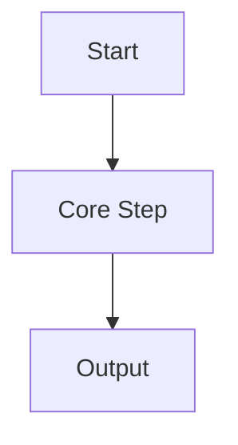

# YYYY-MM-DD · [Topic]

## 🎯 Problem Origin

> Why research this today? Which project triggered it?

## 💡 Core Technical Points

### [Tech Point A]

**What is it**:

**Why designed this way**:

**How to use**:
```python
# minimal working example

```

**Pitfall experiences**:
- ⚠️

---

### [Tech Point B]

**What is it**:

**Why designed this way**:

**How to use**:

**Pitfall experiences**:

---

## 📊 Architecture Diagram



## 🔀 Technical Decision

| Option | Why choose | Why not | Best for |
|--------|-----------|---------|----------|
| A | | | |
| B | | | |

**Decision**: chose **A** because ...

## 🔗 Related Projects

| Project | How this tech is used | Next step |
|---------|----------------------|-----------|
| [[]] | | |

## ❓ Open Issues

### P0 — Blocking
1.

### P1 — Important
1.

### P2 — Nice to have
1.

## 🔄 Knowledge Flow

- [ ] Mature enough to extract to Methodology Library?
- [ ] Will be used frequently → build `.claude/memory` bridge?
- [ ] Worth adding to LLM Wiki (general principle)?

## 🔗 Further Reading

- [[]] —
